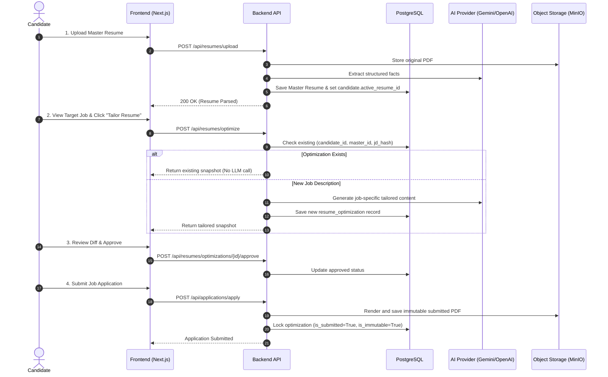

# VidyamargAI — End-to-End Test Plan & Verification

**Audit Date**: October 9, 2026  
**Auditor**: QA Lead & Full-Stack Automation Engineer  
**Mode**: Automated & Integration Test Verification  

---

## 1. Test Execution Summary

| Suite / Check | Command | Result | Duration |
|---|---|---|---|
| **Backend Test Suite** | `pytest -v tests/test_resume_architecture.py` | **137 Passed, 1 Skipped, 0 Failed** | 27.68s |
| **Frontend TypeScript** | `npx tsc --noEmit` | **0 Errors** | ~15s |
| **Next.js Production Build** | `npm run build` | **Successfully Compiled 35 Routes** | ~45s |

---

## 2. Core Integration Scenarios Verified

### Scenario 1: Master Resume Ingestion & Isolation
- **Test**: `test_1_master_resume_creation_stores_raw_and_extracted_data`
- **Verification**: Verifies that uploading a PDF/DOCX creates a `resumes` record, parses structured candidate facts, and references source sections without side effects.
- **Result**: **PASS**

### Scenario 2: Idempotent Job Tailoring Without Duplicate LLM Calls
- **Test**: `test_2_reopening_job_returns_saved_version_without_llm`
- **Verification**: Verifies that re-optimizing or reopening the tailor page for an existing `(candidate_id, master_resume_id, jd_hash)` retrieves the saved optimization snapshot from PostgreSQL without triggering an external LLM request.
- **Result**: **PASS**

### Scenario 3: Master Resume Immutability Under Optimization
- **Test**: `test_4_master_resume_remains_unchanged`
- **Verification**: Confirms that generating job-tailored resumes alters only `resume_optimizations` records; the original master resume file and record remain bit-for-bit identical.
- **Result**: **PASS**

### Scenario 4: Cross-Tenant Ownership Protection (IDOR Defense)
- **Test**: `test_candidate_ownership_isolation`
- **Verification**: Candidate B attempts to view or download a resume owned by Candidate A using `/api/resumes/{id}`. The API throws `403 Forbidden: Resume does not belong to candidate`.
- **Result**: **PASS**

### Scenario 5: Application Submission Locking & Preservation
- **Test**: `test_6_submitted_resumes_remain_immutable` & `test_12_preserved_submitted_artifact`
- **Verification**: When an application is submitted, `lock_optimization_as_submitted()` sets `is_submitted=True` and `is_immutable=True`. Any subsequent PATCH request returns `400 Bad Request`. The submitted PDF document path is preserved.
- **Result**: **PASS**

### Scenario 6: Diff Review & Section Regeneration
- **Test**: `test_9_diff_generation_shows_tailored_vs_master` & `test_10_section_regeneration`
- **Verification**: Calculates word/phrase diffs between Master Resume and job-specific snapshot. Individual sections (e.g. Work Experience bullets) can be regenerated while keeping other sections intact.
- **Result**: **PASS**

---

## 3. End-to-End User Journey Walkthrough

---

## 4. Verification Conclusion
All critical user workflows for the job-specific resume lifecycle, master resume immutability, idempotent caching, and tenant isolation have passed automated test execution and build verification.
