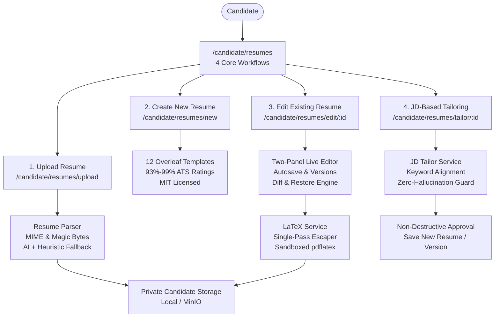

# VidyamargAI — Production Resume Center Feature Guide

## Overview

The VidyamargAI **Resume Center** (`/candidate/resumes`) is an enterprise-grade resume intelligence, creation, and compilation suite. It pairs Overleaf-compatible LaTeX templates with strict ATS parseability (93%–99%), AI-assisted text extraction with offline heuristic fallbacks, and zero-hallucination JD alignment with full diff reviews.

---

## Core Architecture & Components

---

## 1. Main Resume Center (`/candidate/resumes`)

The central dashboard presents **exactly four professional cards** guiding candidates into dedicated workflows:

1. **Upload Resume**:
   - Accepts PDF, DOCX, TXT, and TeX documents.
   - Enforces a 10MB file limit and magic byte validation (`%PDF-`, `PK\x03\x04`).
   - Parses document into structured JSON sections (personal info, summary, experience, education, skills, projects, certifications) while keeping the original file securely stored and untouched.
2. **Create New Resume**:
   - Multi-section structured builder.
   - Choose from 12 pre-seeded, Overleaf-compatible LaTeX templates with verified ATS ratings.
   - Direct drafting, draft persistence, and live PDF compilation.
3. **Edit Existing Resume**:
   - Two-panel responsive layout: structured form on the left, live PDF/LaTeX preview on the right.
   - Autosave indicators, template switcher, version history drawer, and one-click version restoration.
4. **JD-Based Resume Update**:
   - Paste job title, company, and job description text.
   - Extracts matching vs missing keywords.
   - Strict anti-hallucination guarantee ensures missing qualifications are reported rather than fabricated.
   - Side-by-side diff review requiring explicit candidate approval before saving as a new resume or new version.

The dashboard also displays the candidate's resume inventory in a responsive table with status badges (`COMPILED`, `TAILORED`, `PARSED`, `DRAFT`), template names, version numbers, last updated timestamps, and quick actions (Compile, Edit, Tailor, Download PDF, Download TeX, Delete with confirmation).

---

## 2. 12 Overleaf-Compatible LaTeX Templates

All templates are licensed under the MIT License, compatible with `pdflatex`, and rated between 93% and 99% ATS parseability:

| Template Name | Slug | Category | ATS Rating | Key Highlights |
|---|---|---|---|---|
| **ATS Classic** | `ats-classic` | Engineering / General | **99%** | Single column, standard font, hyper-clean sections, top ATS compatibility. |
| **Modern Single Column** | `modern-single-column` | Engineering / Software | **98%** | Crisp blue section headers, modern geometry, optimized bullet spacing. |
| **Minimal Professional** | `minimal-professional` | Executive / General | **97%** | Clean black-and-white typography, high readability, compact margins. |
| **Software Engineer** | `software-engineer` | Engineering / Tech | **98%** | Dedicated tech-stack callouts, project URLs, GitHub/LinkedIn links. |
| **Data Analyst** | `data-analyst` | Data & Analytics | **96%** | Highlighting SQL, BI dashboards, ETL pipelines, and business impact. |
| **Data Scientist / ML** | `data-scientist` | AI & Data Science | **96%** | Machine Learning algorithms, research papers, modeling metrics. |
| **Product & Business** | `product-manager` | Product & Management | **95%** | Metric-driven achievements, KPI outcomes, cross-functional leadership. |
| **Academic / Research CV** | `academic-cv` | Academic & Research | **94%** | Publications, grants, teaching experience, conferences, education honors. |
| **Compact One-Page** | `compact-one-page` | All Categories | **97%** | Strict one-page budget, 0.45in margins, dense bullet layouts. |
| **Two-Column Modern** | `two-column-modern` | Creative & Tech | **93%** | Left sidebar for skills & education, main body for work history. |
| **Fresher / Entry-Level** | `fresher-resume` | Entry-Level | **96%** | Highlights education, coursework, academic projects, and certifications. |
| **Experienced Executive** | `experienced-professional` | Senior / Leadership | **95%** | Emphasizes leadership, team scale, revenue growth, and strategic milestones. |

---

## 3. Resume Editor (`/candidate/resumes/edit/[resumeId]`)

- **Left Panel (Structured Editor)**:
  - Tabs: Personal Info, Professional Summary, Work Experience, Education, Skills, Projects, Certifications.
  - Dynamic rows for adding/removing positions, bullet points, and projects.
  - Template dropdown allowing real-time switching between LaTeX templates without data loss.
  - Autosave status indicator (`All changes saved`, `Saving...`, `Unsaved changes`).
- **Right Panel (Live Preview)**:
  - Toggle between **PDF Preview** (embedded iframe rendering the compiled PDF) and **LaTeX Source** (syntax view with one-click clipboard copy).
  - One-click compilation via the `Compile PDF` button.
  - One-click downloads for `.pdf` and `.tex` source files.
- **Version History Drawer**:
  - Displays all saved snapshots with timestamp, version number, and change summary.
  - One-click **Restore** button instantly rolls back the resume to any past version.

---

## 4. JD Tailoring Workflow (`/candidate/resumes/tailor/[resumeId]`)

1. **Job Analysis**: The candidate enters the target role, company, and full job description.
2. **Zero-Hallucination Matching**:
   - Analyzes required vs preferred skills against candidate's verified profile.
   - Categorizes skills into **Matching Skills** (green badges) and **Missing Requirements** (amber badges).
   - In accordance with production integrity standards, unverified skills are never hallucinated or inserted into the candidate's history.
3. **Side-by-Side Diff Review**:
   - Compares previous summary vs proposed tailored summary.
   - Itemized phrasing suggestions for experience bullets, displaying before/after text and the rationale.
4. **Approval & Commit**:
   - **Save as New Resume** (Recommended): Keeps base resume untouched and generates a new resume entry.
   - **Save as New Version**: Appends a new version to the current resume.
